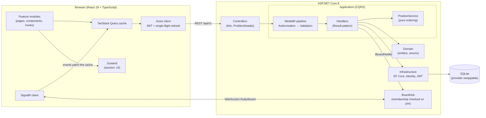

# TaskFlow

A Trello-style project management platform: workspaces, boards, drag-and-drop Kanban with optimistic updates,
realtime collaboration over SignalR, comments with `@mentions`, an activity log and notifications.

Built as a portfolio project to show production habits rather than just features: Clean Architecture on the backend,
a pure and well-tested ordering algorithm, optimistic concurrency, policy-based authorization, a typed API contract
shared with the frontend, and tests at every level (unit, HTTP integration, SignalR, component, E2E, accessibility).

<!-- Replace with a recording of the board: drag a card, open it, watch a second browser update live. -->


## Features

- **Auth**: register, login, short-lived JWT access tokens with refresh-token rotation and reuse detection.
- **Workspaces**: create, rename, delete; invite members by email; roles Owner / Admin / Member enforced on every endpoint
  and mirrored in the UI.
- **Boards and columns**: create, archive (read-only), delete; add, rename, delete and reorder columns.
- **Cards**: create, edit (title, description, due date), labels, assignees, delete, drag between and within columns.
- **Comments**: add, edit (author only), delete (author or admin), `@mentions` that notify workspace members.
- **Activity log** per card and per board, **notifications** for assignments and mentions.
- **Search and filter** by text, label, assignee and due date; the filters live in the URL.
- **Realtime**: other people's changes appear without reloading; a "Reconnecting…" indicator shows connection loss.
- **Accessibility**: dialogs trap focus and return it, menus use arrow keys, drag and drop works with the keyboard
  (Space to pick up, arrows to move, Space to drop), live regions announce moves, WCAG AA contrast in light and dark.

## Architecture



Dependencies point inwards: `Api → Infrastructure → Application → Domain`. The Application layer owns the interfaces
(`IApplicationDbContext`, `IBoardNotifier`, `ICurrentUser`), so handlers are tested with a real DbContext on in-memory
SQLite and no HTTP at all.

The OpenAPI document (`backend/openapi.json`) is generated from the API and turned into TypeScript types for the
frontend (`npm run api:sync`), so a contract change that breaks the UI fails the type check. CI fails when the committed
document is out of date.

## Tech stack

| Area     | Choices                                                                                                                                                                                                                      |
| -------- | ---------------------------------------------------------------------------------------------------------------------------------------------------------------------------------------------------------------------------- |
| Backend  | .NET 8, controllers, EF Core 8 + SQLite, MediatR, FluentValidation, Mapster, ASP.NET Identity + JWT, SignalR, Serilog, Swagger, API versioning, rate limiting, health checks                                                 |
| Frontend | React 18, TypeScript (strict, `noUncheckedIndexedAccess`, no `any`), Vite, Tailwind CSS v3 (own UI primitives, no component library), React Router 6, TanStack Query, Zustand, React Hook Form + Zod, @dnd-kit, lucide-react |
| Testing  | xUnit, FluentAssertions, NSubstitute, WebApplicationFactory, coverlet · Vitest, React Testing Library, MSW, user-event · Playwright + axe-core                                                                               |
| Tooling  | ESLint (typescript-eslint, react-hooks, jsx-a11y, tailwindcss), Prettier, Husky + lint-staged, GitHub Actions                                                                                                                |

## Run it

Prerequisites: .NET 8 SDK, Node 20+. No Docker, no database server.

```bash
# 1. API on http://localhost:5080  (creates the SQLite file and seeds demo data in Development)
cd backend
dotnet run --project src/TaskFlow.Api --launch-profile http

# 2. Web app on http://localhost:5173
cd frontend
npm install
npm run dev
```

Sign in with `demo@taskflow.dev` / `Password123` (also `alice@taskflow.dev` and `bob@taskflow.dev`, same password).
Open two browsers with two of these users to see realtime updates. Swagger UI is at `http://localhost:5080/swagger`.

Configuration lives in `backend/src/TaskFlow.Api/appsettings*.json`; the database provider and connection string are
config values (`Database:Provider`, `ConnectionStrings:Default`). In Production a real `Jwt:Key` is required.

## Test it

```bash
# Backend: unit + integration (real HTTP, real SignalR) with the 80% coverage gate on the Application layer
cd backend
dotnet test                       # just run the tests
bash scripts/coverage.sh          # tests + coverage report in backend/coverage, fails below 80%

# Frontend
cd frontend
npm run lint && npx tsc --noEmit  # static checks
npm test                          # unit + component + hook tests
npm run test:coverage             # with coverage thresholds

# End to end (starts the API on a throw-away database and the dev server by itself)
npx playwright install chromium   # once
npm run e2e
```

Regenerate the API types after changing the backend: `cd frontend && npm run api:sync`.

## API overview

All routes are under `/api/v1` and need a bearer token except register, login and refresh. Errors are RFC 7807
problem details with a stable `code`. See `NOTES.md` for the conventions and `backend/openapi.json` for the full contract.

| Area          | Endpoints                                                                                                                                                                                   |
| ------------- | ------------------------------------------------------------------------------------------------------------------------------------------------------------------------------------------- |
| Auth          | `POST auth/register`, `auth/login`, `auth/refresh`, `auth/logout` · `GET auth/me`                                                                                                           |
| Workspaces    | `GET/POST workspaces` · `GET/PUT/DELETE workspaces/{id}` · `GET/POST workspaces/{id}/members` · `PUT/DELETE …/members/{userId}`                                                             |
| Boards        | `GET/POST workspaces/{id}/boards` · `GET/PUT/DELETE boards/{id}` · `PUT boards/{id}/archive`                                                                                                |
| Columns       | `POST boards/{id}/columns` · `PUT/DELETE columns/{id}` · `PUT columns/{id}/move`                                                                                                            |
| Cards         | `GET boards/{id}/cards` (filter, sort, page) · `POST columns/{id}/cards` · `GET/PUT/DELETE cards/{id}` · `PUT cards/{id}/move`, `/labels`, `/assignees`                                     |
| Labels        | `POST boards/{id}/labels` · `PUT/DELETE labels/{id}`                                                                                                                                        |
| Comments      | `GET/POST cards/{id}/comments` · `PUT/DELETE comments/{id}`                                                                                                                                 |
| Activity      | `GET boards/{id}/activity` · `GET cards/{id}/activity`                                                                                                                                      |
| Notifications | `GET notifications` · `GET notifications/unread-count` · `POST notifications/{id}/read`, `notifications/read-all`                                                                           |
| Realtime      | SignalR hub `/hubs/board`: `JoinBoard(boardId)`, `LeaveBoard(boardId)`; events `CardCreated`, `CardUpdated`, `CardMoved`, `CardDeleted`, `CommentAdded`, `CommentDeleted`, `ColumnsChanged` |
| Ops           | `GET /health`, Swagger UI at `/swagger`                                                                                                                                                     |

## Design decisions

- **Ordering with fractional positions.** Cards and columns carry a `double` position. A move sends the ids of the
  neighbours, not a number; the server places the item at the midpoint and renumbers the siblings only when the gap
  runs out. The algorithm is a pure service with property-style tests, and the client runs the same logic to predict
  the result for optimistic updates.
- **Optimistic concurrency.** Cards have an integer `Version` used as an EF concurrency token. Edits and moves send
  the version they saw; a mismatch is a `409` problem details response and the UI refetches and explains it.
- **Authorization as a pipeline behavior.** Every request declares the resource it touches and the minimum role. One
  MediatR behavior resolves the workspace, checks membership and role, and answers `404` for non-members (so existence
  is not leaked) and `403` for members with too little privilege.
- **Realtime that cannot corrupt the cache.** Events carry the actor's id so the sender ignores its own echo, are
  validated with Zod, drop out-of-date versions, and reuse the same pure cache transformations as optimistic updates.
  After a reconnect the board is refetched, because events sent while offline are lost.
- **Tests where the risk is.** Pure logic is unit tested, handlers run against a real database, HTTP and SignalR are
  tested through the real pipeline, and Playwright drives the real stack including a real mouse drag and two users.

## Known limitations

- Tokens are stored in `localStorage` (simple, but exposed to XSS); a hardened setup would use httpOnly cookies.
- Migrations target SQLite. The provider is configurable, but other providers need their own migrations.
- An invitee must already have an account; there are no invitation emails and no ownership transfer.
- Position ties from simultaneous appends are tolerated and repaired on the next move rather than serialized.
- Search returns at most 200 cards per page and the board loads all pages, so very large boards load slowly.
- Notifications refresh by polling every 30 seconds; only board events are pushed.
- Editing a comment does not notify newly mentioned people, and there is no `@mention` autocomplete.
